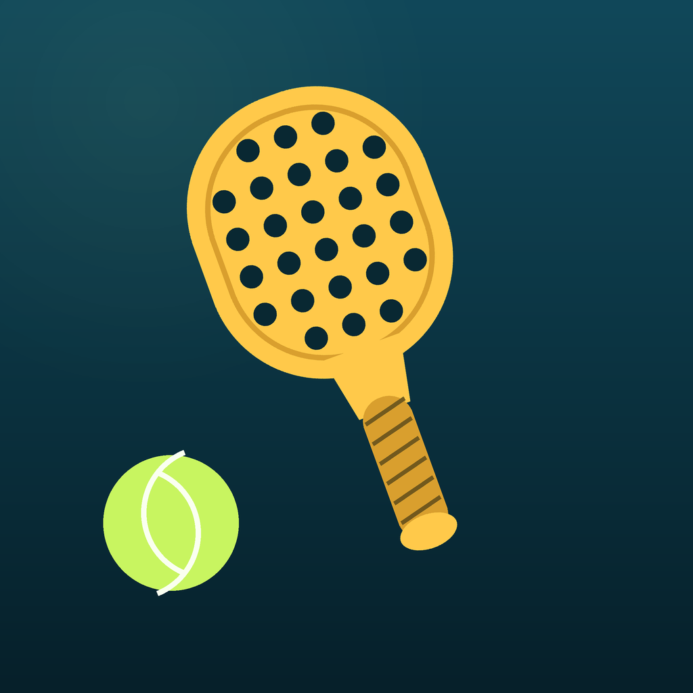

# 🎾 Familien Vestergaard Padel Championship

En Americano padel-app til iOS, bygget i SwiftUI. Helt på dansk, og med en
kommentatorboks der ikke skåner nogen i familien. Undtagen Maria.

<p align="center">
  
</p>

## Hvad er Americano?

Alle spiller med alle og mod alle. Man skifter makker hver runde, og point
følger **spilleren** – ikke holdet. En kamp slutter, når de to holds point
tilsammen når målet (som standard 21). Til sidst står der én tilbage med flest
point, og resten skal høre for det til jul.

## Funktioner

- **Sæt holdet mens kampen kører.** Første kamp starter med tomme pladser – tryk
  på en plads og vælg spilleren, også midt i en igangværende kamp. Man kan
  skifte spillere ud undervejs uden at miste stillingen.
- **Automatisk Americano-program.** Resten af runderne lægges, så snart første
  runde er godkendt, og den faktiske opstilling tæller med i fordelingen. Så
  spiller alle med alle, mod alle, og pauserne fordeles ligeligt.
- **Kommentatorboksen.** Hver eneste point udløser en kommentar, skræddersyet
  til den spiller der scorede – og til om vedkommende er foran eller bagud.
- **Live stilling** med podie, pointforskel, sejre og nederlag.
- **Program-oversigt** over alle runder, baner og resultater.
- **Mester-skærm** med konfetti, pokal og en sidsteplads ingen slipper for.
- **Alt gemmes automatisk**, så turneringen overlever at appen lukkes.
- Flere baner samtidig, justerbart antal runder og point pr. kamp, og
  gæstespillere kan tilføjes undervejs.

## Holdet

| Spiller | Kommentatorboksens holdning |
| --- | --- |
| 🔵 **Henrik** | Chelsea og Vejle Boldklub. Får klubberne i hovedet både når han fører og når han er bagud. |
| 🌸 **Maria** | Konstant ros, opbakning og god energi. Stillingen betyder intet, Maria betyder alt. |
| 😤 **Thomas** | Altid bedst. Dybt irriterende. Et nederlag er en historisk begivenhed. |
| 🎯 **Majbritt** | Undersælger sig selv i hver eneste sætning. Er teknisk den bedste på banen. |
| 👨‍💻 **Jens** | Bedre til at kode denne app end til at spille padel. Den venstrehånds-noob. |
| 😇 **Casper** | For god og for sød. Og på uforklarlig vis også god til padel. |

Tilføjer man andre spillere, får de neutrale kommentarer – familiens replikker
er reserveret til familien.

## Kom i gang

Kræver **Xcode 15 eller nyere** og **iOS 17+**.

```bash
git clone <repo-url>
cd FamilyPadel
open FamilyPadel.xcodeproj
```

Vælg en simulator (eller din egen iPhone) og tryk ⌘R.

Skal den på din egen telefon, skal du sætte dit eget udviklerteam:
**FamilyPadel-target → Signing & Capabilities → Team**. Skift eventuelt
`PRODUCT_BUNDLE_IDENTIFIER` fra `com.vestergaard.familypadel`, hvis Xcode
brokker sig over at id'et er taget.

## Sådan spiller I

1. **Opsætning** – tjek spillerne, vælg point pr. kamp, antal baner og runder.
2. **Start turneringen** – første kamp går i gang med det samme.
3. **Sæt holdet** – tryk på "Vælg" på hver plads. Det kan sagtens gøres, mens
   I allerede er i gang. "Auto" fylder pladserne ud for jer.
4. **Tæl point** – tryk på det store point-felt hos det hold der scorer.
   Kommentatorboksen tager sig af resten.
5. **Godkend kampen** når pointmålet er nået, og fortsæt til næste runde.
6. **Kår mesteren** når alle runder er spillet.

## Projektets opbygning

```
FamilyPadel/
├── FamilyPadelApp.swift        App-indgang
├── Models/                     Player, PadelMatch, Tournament, Persona
├── Engine/
│   ├── AmericanoScheduler.swift  Programlægning med balancerede pauser
│   └── Banter.swift              Kommentatorboksens replikbank
├── Store/TournamentStore.swift Al spillogik og lagring
└── Views/                      SwiftUI-skærme
```

Vil du tilføje flere jokes, ligger de samlet i `Engine/Banter.swift` – én
funktion pr. familiemedlem. `{n}` bliver erstattet med spillerens fornavn.
